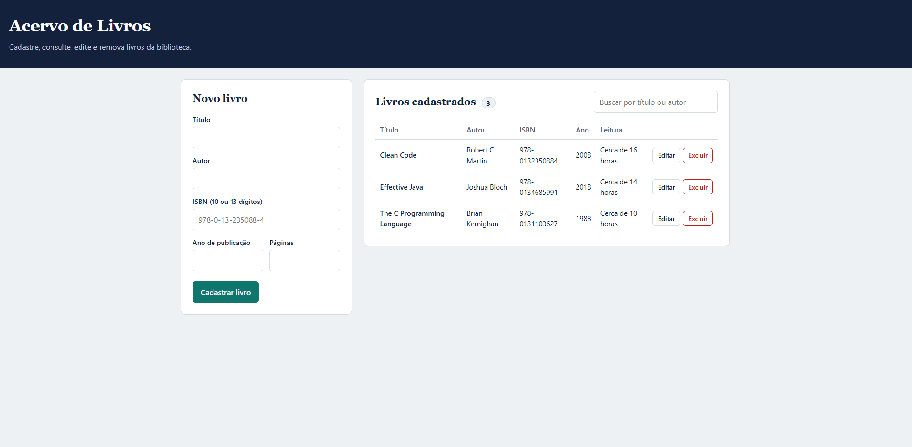
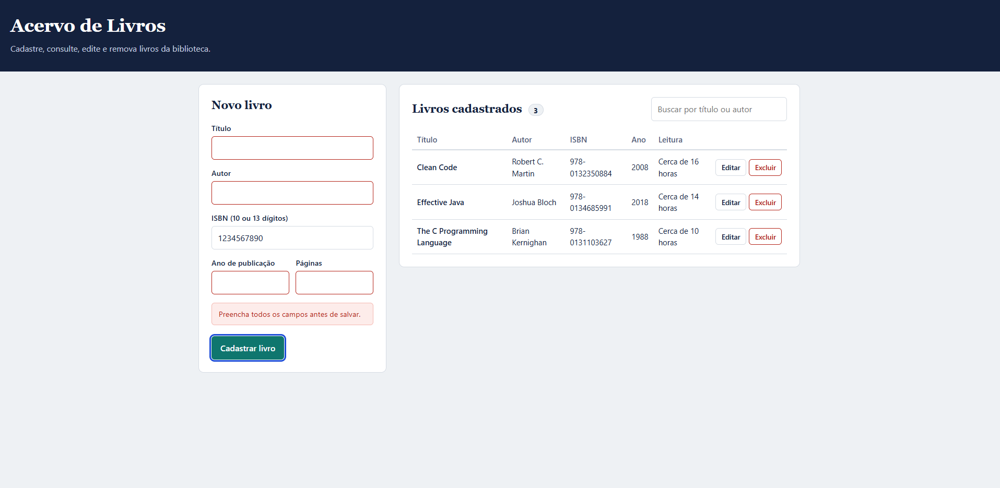
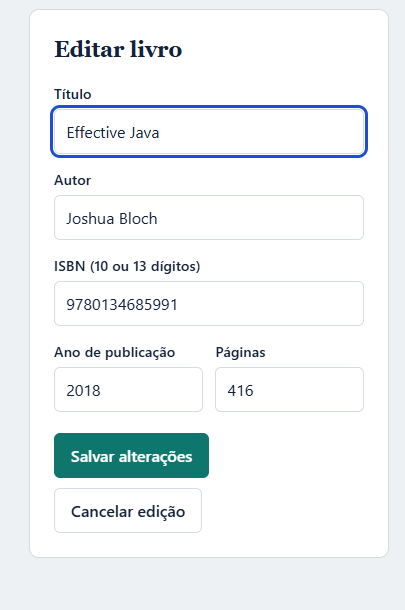
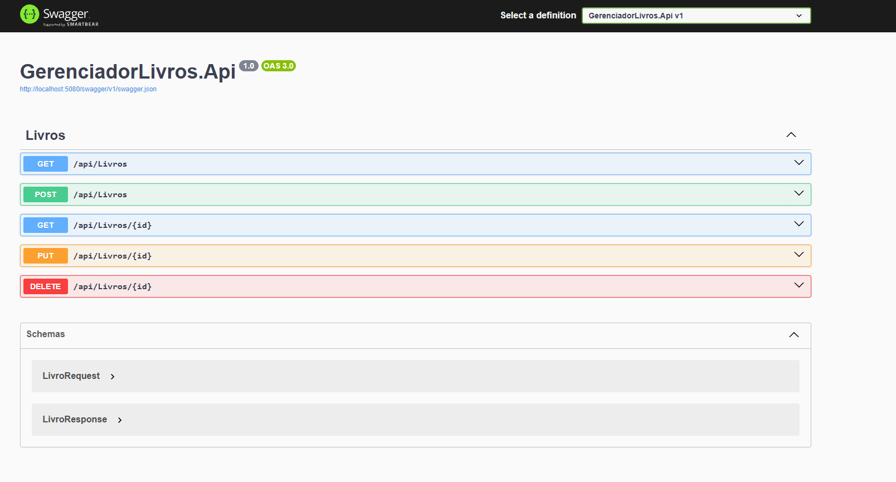

# Acervo de Livros — Web API com ASP.NET Core e CRUD em Página Web

**Disciplina:** CBTSWE2 – ADS 671 · IFSP Câmpus Cubatão · Prof. Wellington Tuler Moraes
**Trabalho Prático 04:** Desenvolvimento de Web API com ASP.NET Core e CRUD em Página Web

**Alunos:** André Nascimento de Andrade e João do Valle Seixas Paula

## Sobre o projeto

Sistema para gerenciar um acervo de livros. Uma Web API em ASP.NET Core expõe o CRUD da entidade `Livro`, grava os dados em um banco SQLite local com Entity Framework Core e é consumida por uma página web (HTML, CSS e JavaScript) servida pela própria API.

## Tecnologias

| Item | Tecnologia |
|---|---|
| Plataforma | .NET 8 / ASP.NET Core Web API |
| Banco de dados | SQLite (arquivo `livros.db`, criado automaticamente) |
| ORM | Entity Framework Core 8 |
| DLL própria | `GerenciadorLivros.Utils` (biblioteca de classes) |
| Página web | HTML + CSS + JavaScript (`fetch`) |
| Documentação da API | Swagger (Swashbuckle) |
| Testes | xUnit + EF Core InMemory |

## Estrutura da solução

```
GerenciadorLivros/
├── GerenciadorLivros.sln
├── GerenciadorLivros.Api/            # Web API + página web
│   ├── Controllers/LivrosController.cs
│   ├── Data/AppDbContext.cs          # EF Core
│   ├── Dtos/LivroDtos.cs             # LivroRequest / LivroResponse
│   ├── Middleware/ExceptionHandlingMiddleware.cs
│   ├── Models/Livro.cs
│   ├── wwwroot/                      # index.html, style.css, app.js
│   └── Program.cs
├── GerenciadorLivros.Utils/          # DLL com regras reutilizáveis
│   ├── IsbnValidador.cs              # valida/normaliza/formata ISBN-10 e ISBN-13
│   ├── FormatadorTexto.cs            # capitaliza títulos e autores
│   └── CalculadoraLeitura.cs         # estima o tempo de leitura
└── GerenciadorLivros.Tests/          # testes unitários (xUnit)
```

## Como executar

Pré-requisitos: [.NET SDK 8](https://dotnet.microsoft.com/download) e VS Code com a extensão **C# Dev Kit**.

```bash
dotnet restore
dotnet run --project GerenciadorLivros.Api
```

Ou pressione **F5** no VS Code (configuração "Executar API + Página Web").

- Página web: http://localhost:5080
- Swagger: http://localhost:5080/swagger

O banco `livros.db` é criado automaticamente na primeira execução.

## Como rodar os testes

```bash
dotnet test
```

## Endpoints

| Método | Rota | Descrição | Respostas |
|---|---|---|---|
| GET | `/api/livros` | Lista livros (`?busca=` filtra por título/autor) | 200 |
| GET | `/api/livros/{id}` | Busca um livro | 200, 404 |
| POST | `/api/livros` | Cadastra um livro | 201, 400, 409 |
| PUT | `/api/livros/{id}` | Atualiza um livro | 200, 400, 404, 409 |
| DELETE | `/api/livros/{id}` | Exclui um livro | 204, 404 |

Exemplo de corpo (POST/PUT):

```json
{
  "titulo": "clean code",
  "autor": "robert c. martin",
  "isbn": "978-0-13-235088-4",
  "anoPublicacao": 2008,
  "numeroPaginas": 464
}
```

## Integração com a DLL

A API referencia o projeto `GerenciadorLivros.Utils` (gera `GerenciadorLivros.Utils.dll`) e o usa para:

- **Validar o ISBN** (dígito verificador) antes de gravar → retorna 400 se for inválido;
- **Padronizar título e autor** (`"clean code"` → `"Clean Code"`);
- **Enriquecer a resposta** com `isbnFormatado` e `tempoLeituraEstimado`.

## Boas práticas aplicadas

- Separação em camadas/projetos (API, DLL, testes) e DTOs separados da entidade.
- Validação com Data Annotations e regras de negócio na DLL.
- Códigos HTTP adequados (200, 201, 204, 400, 404, 409).
- Tratamento global de exceções com middleware (`ProblemDetails`) e logs.
- Índice único no ISBN no banco.
- Nomenclatura consistente e comentários XML nos métodos principais.
- Página web sem inserção de HTML bruto (uso de `textContent`), evitando XSS.

## Funcionalidades da página web

1. **Listar** todos os livros em tabela, com contador.
2. **Buscar** por título ou autor.
3. **Cadastrar** um livro pelo formulário (com mensagens de erro vindas da API).
4. **Editar** um livro (o formulário muda para o modo de edição).
5. **Excluir** um livro, com confirmação.

## Capturas de tela


### Página inicial

Tabela com os livros cadastrados, busca por título ou autor e contador. O ISBN formatado e o tempo de leitura estimado vêm da DLL.

### Validação de ISBN

Quando o ISBN é inválido, a API retorna erro 400 e a página exibe a mensagem.

### Edição

Ao clicar em Editar, o formulário é preenchido com os dados do livro e passa para o modo de edição.

### Swagger

Documentação interativa dos endpoints da API.

